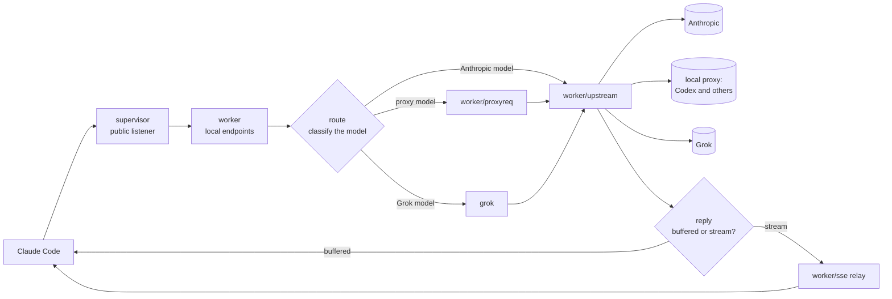

# Package map

This page shows how the Go port is organized: what each package does, which Node file it replaces, and how far it
is. Read it top to bottom once; after that, use the index at the end to go from a Node file to its Go packages.

The plan (`model-gateway-go-port.md`, section 3.2 and the phase table) is the authority for the mapping and the
phases. The status marks here are a snapshot taken on 2026-11-28 and are updated at each phase gate.

Go packages are relative to `internal/`. Node paths are relative to the pinned source tree.

## The gateway in one picture

Claude Code talks to one local address. Behind it, a long-lived supervisor accepts connections and hands each request
to a worker process, which decides where the request goes and relays the answer.

Three things watch every request without changing where it goes: the context sentry (`worker/sentry`) refuses a
request that would overflow the model's window, the compaction guard (`worker/compactguard`) retries a compaction
that came back incomplete, and the observers (`usage`, `telemetry`) record counts and route decisions, never
message content.

## Status marks

| Mark | Meaning |
|---|---|
| ✅ | Production code is on `main` |
| 🔶 | Code exists on a branch and is in independent review, or is partly on `main` (the note says which part) |
| 🔜 | Not started; the phase column says when |

Phases: 0 foundations, 1 pure logic, 2 worker, 3 supervisor and process layer, 4 command line and settings,
5 packaging, migration and shadow mode, 6 rehearsal and cutover. Phases 0 and 1 are on `main`; phase 2 passed its
gate, and its status commit is intended to land it on `main` after independent verification; phase 3 is next.

## 1. The request path (worker)

What happens to one inference request, in the order it happens.

| Package | What it does | Replaces | Phase | Status |
|---|---|---|---|---|
| `worker` | Serves the local endpoints and runs a request through the steps below | `lib/request-worker.js` (server part) | 2 | ✅ |
| `worker/route` | Classifies the requested model: Anthropic, proxy, Grok, or refused | `lib/request-worker.js` | 1 | ✅ |
| `worker/dispatch` | Recognizes route markers in a conversation and remembers a session's route | `lib/request-worker.js` | 1 | ✅ |
| `worker/sentry` | Tracks context usage per session and refuses a request that cannot fit | `lib/request-worker.js` | 1 | ✅ |
| `worker/proxyreq` | Builds the request for a proxy model and answers local refusals | `lib/request-worker.js` | 2 | ✅ |
| `grok` | Translates between Anthropic messages and Grok's wire format, and keeps the Grok credential fresh | `lib/grok-backend.js` | 1, 2 | ✅ |
| `toolschema` | Adapts tool input schemas for Codex | `lib/tool-schema-compat.js` | 1 | ✅ |
| `worker/upstream` | Filters headers and sends the request to Anthropic, the proxy or Grok | `lib/request-worker.js` | 2 | ✅ |
| `worker/reply` | Handles a buffered answer: errors, retries, overflow, rejections | `lib/request-worker.js` | 2 | ✅ |
| `worker/sse`, `sse` | Relays a streamed answer to the client; `sse` splits the event stream | `lib/request-worker.js` | 1, 2 | ✅ |
| `worker/compactguard` | Buffers a compaction stream and retries it when it is incomplete | `lib/request-worker.js` | 2 | ✅ |
| `worker/modelcache` | Keeps the model list current and serves `/v1/models` | `lib/request-worker.js` | 2 | ✅ |
| `worker/outcome` | Carries the facts of one request (route, status) between the steps | `lib/request-worker.js` | 2 | ✅ |
| `worker/compose` | Wires all of the above into one worker | new | 2 | ✅ |

## 2. Processes: supervisor, worker lifecycle, ownership

Who listens, who starts and stops whom, and how the gateway knows a process is its own.

| Package | What it does | Replaces | Phase | Status |
|---|---|---|---|---|
| `supervisor`, `supervisor/relay`, `supervisor/workerproc` | Owns the public listener, starts and replaces workers, relays requests to them | `lib/commands.js` (supervisor part) | 2, 3 | 🔶 skeleton ✅; the rest is phase 3 |
| `cli/serveshim`, `cli/serveworker` | The two long-running commands: supervisor and worker | `lib/commands.js` | 2 | ✅ |
| `procinfo` | Reads process and listener facts from the operating system | `lib/process-supervision.js` | 0 | ✅ |
| `ownership`, `supervisor/proxyrecovery`, `launch` | Decide which processes belong to the gateway, recover the proxy, start detached processes | `lib/process-supervision.js`, `lib/windows-detached.js` | 3 | 🔜 |
| `shimstate` | Works out whether a gateway already answers on the port and whether it is this install's | `lib/shim-state.js` | 3 | 🔜 |
| `lifecycle` | Serializes start, stop and repair, and records what happened | `lib/lifecycle-lock.js`, `lib/lifecycle-diagnostics.js` | 1 | ✅ |
| `controlauth` | Authorizes local start and stop requests | `lib/control-auth.js` | 1 | ✅ |

## 3. Models, catalogs and policy

Which models exist, which one a picker alias means, and what limits apply.

| Package | What it does | Replaces | Phase | Status |
|---|---|---|---|---|
| `policy` | Resolves model identities, context windows and compaction limits | `lib/runtime.js`, `lib/context-window.js` | 1 | ✅ |
| `pins` | Chooses the model behind each picker alias | `lib/pins.js`, `lib/previous-picker-rows.js` | 1, 4 | 🔶 logic ✅; live probe in phase 4 |
| `anthropiccatalog` | Stores snapshots of Anthropic's model catalog and merges picker rows | `lib/anthropic-catalog.js` | 1 | ✅ |
| `proxymodels` | Reads the model listing the proxy serves | `lib/proxy-models.js` | 1 | ✅ |
| `localprov`, `proxyconfig` | Read local providers (LM Studio, llama.cpp) and the proxy's configuration | `lib/lmstudio.js`, `lib/local-llama.js`, `lib/proxy-config.js` | 1, 2 | ✅ |
| `catalog` | Builds the catalog document other tools consume | `lib/commands.js` | 1 | ✅ |
| `pickerguard` | The model-picker guard that `ensure` runs; it keeps its own state file | `lib/picker-guard.js` | 4 | 🔜 |

## 4. Settings, installation and files

How the gateway writes itself into Claude Code's settings and keeps its own files safe.

| Package | What it does | Replaces | Phase | Status |
|---|---|---|---|---|
| `wiring` | Adds and removes the gateway's entries in Claude settings and project registrations | `lib/settings-wiring.js` | 1, 4 | 🔶 logic ✅; commands in phase 4 |
| `readiness` | Decides whether recovery applies to the effective settings | `lib/readiness-hooks.js`, `lib/recovery-policy.js`, `lib/readiness-gate.js` | 1, 4 | 🔶 logic ✅; commands in phase 4 |
| `paths`, `config` | Resolve every path and environment variable in one place | `lib/runtime.js` | 0, 1 | ✅ |
| `install` | Reads the installed-plugin registries and compares versions | `lib/runtime.js` | 1 | ✅ |
| `atomicfile` | Replaces state and settings files atomically and appends journal records | `lib/atomic-file.js` | 0 | ✅ |
| `jsonx` | Edits the gateway's own keys without rewriting the rest of a JSON file | new | 0 | ✅ |
| `selfinstall` | Installs the binary at its stable path and writes the launchers | `hooks/registry-writer.js` | 4, 5 | 🔜 |
| `release` | Downloads and verifies a release | `lib/github-release.js`, `lib/release-verification.js` | 4 | 🔜 |

## 5. Observability and upstream state

| Package | What it does | Replaces | Phase | Status |
|---|---|---|---|---|
| `usage` | Builds and emits counts-only usage records | `lib/usage-observability.js` | 1, 2 | ✅ |
| `telemetry` | Records route decisions as spans and a local log, without message content | `lib/request-worker.js` | 2 | ✅ |
| `upstreamstate` | Remembers that Codex refused dispatch, with evidence and expiry | `lib/codex-upstream-state.js` | 1 | ✅ |
| `jsdate` | Parses dates the way the Node code's `Date.parse` did, independent of the time zone; used by the two packages above | new | 1 | ✅ |

## 6. Command line

| Package | What it does | Replaces | Phase | Status |
|---|---|---|---|---|
| `cli`, `cli/argscan` | Register the commands and read arguments the way the Node CLI does | `lib/commands.js` | 0 | ✅ |
| `cli/version`, `cli/completions` | `version` and shell completions | `lib/commands.js` | 0 | ✅ |
| `cli/<command>`, `doctor`, `status` | One package per remaining command (`setup`, `ensure`, `env`, `pin`, `stop`, ...) | `lib/commands.js` | 3, 4 | 🔜 |

## 7. Moving from the Node version

| Package | What it does | Replaces | Phase | Status |
|---|---|---|---|---|
| `migrate` | Switches a home from the Node gateway to the Go one, with a journal and a rollback | new | 5 | 🔜 |
| `shadow` | Runs a second, isolated instance beside the live one for a soak, and reports on it | new | 5 | 🔜 |
| `plugin/`, `.claude-plugin/marketplace.json` | The Claude Code plugin and its marketplace entry (not Go) | the Node plugin | 5 | 🔜 |

Not ported: `lib/remote-control.js`. The Go version never writes the hosts file. It only detects, read-only, the hosts
block the Node version manages, in `doctor` and in the migration check.

## 8. Test support

| Package | What it does | Phase | Status |
|---|---|---|---|
| `venue` | Refuses to run a test binary on a machine that runs a real gateway | 0 | ✅ |
| `gatewaytest` | Gives tests an isolated home, environment and child processes | 0 | ✅ |
| `test/conformance/` | Runs the same cases against the Node gateway and the Go binary (not a Go package) | 2 | ✅ the Go binary passes the 177 cases due through phase 2; later cases run at their phase gates |

## Index: from a Node file to its Go packages

| Node file | Go packages | Section |
|---|---|---|
| `lib/request-worker.js` | `worker` and everything under it, `sse`, `telemetry` | 1, 5 |
| `lib/commands.js` | `cli` and everything under it, `supervisor`, `catalog`, `doctor`, `status` | 2, 3, 6 |
| `lib/process-supervision.js` | `procinfo`, `ownership`, `supervisor/proxyrecovery`, `launch` | 2 |
| `lib/runtime.js` | `paths`, `config`, `policy`, `install` | 3, 4 |
| `lib/usage-observability.js` | `usage` | 5 |
| `lib/settings-wiring.js` | `wiring` | 4 |
| `lib/pins.js`, `lib/previous-picker-rows.js` | `pins` | 3 |
| `lib/grok-backend.js` | `grok` | 1 |
| `lib/tool-schema-compat.js` | `toolschema` | 1 |
| `lib/remote-control.js` | not ported | 7 |
| `lib/anthropic-catalog.js` | `anthropiccatalog` | 3 |
| `lib/proxy-models.js`, `lib/proxy-config.js` | `proxymodels`, `proxyconfig` | 3 |
| `lib/lmstudio.js`, `lib/local-llama.js` | `localprov` | 3 |
| `lib/picker-guard.js` | `pickerguard` | 3 |
| `lib/context-window.js` | `policy` | 3 |
| `lib/lifecycle-lock.js`, `lib/lifecycle-diagnostics.js` | `lifecycle` | 2 |
| `lib/codex-upstream-state.js` | `upstreamstate` | 5 |
| `lib/control-auth.js` | `controlauth` | 2 |
| `lib/shim-state.js` | `shimstate` | 2 |
| `lib/windows-detached.js` | `launch` | 2 |
| `lib/readiness-hooks.js`, `lib/recovery-policy.js`, `lib/readiness-gate.js` | `readiness` | 4 |
| `lib/atomic-file.js` | `atomicfile` | 4 |
| `lib/github-release.js`, `lib/release-verification.js` | `release` | 4 |
| `hooks/registry-writer.js` | `selfinstall` | 4 |
